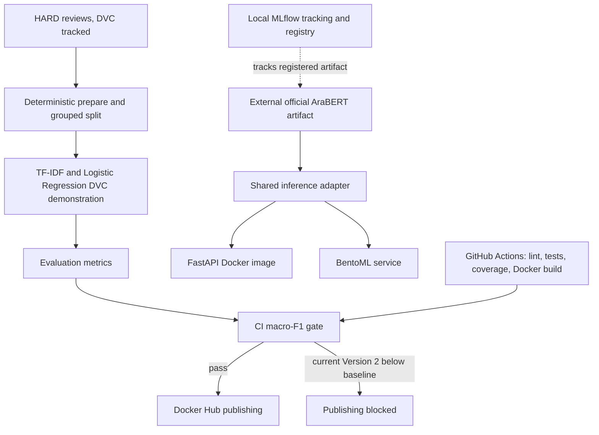

# Arabic Sentiment Analysis MLOps

[](https://github.com/m73hashem/arabic-sentiment-mlops/actions/workflows/ci.yml)

A reproducible MLOps project for Arabic hotel-review sentiment classification using the official full-GPU AraBERTv0.2-base model, FastAPI, BentoML, MLflow, DVC, GitHub Actions, and Docker. The current classifier is binary: ratings 1–2 map to `negative` and 4–5 to `positive`; neutral rating 3 is not modeled.

## Installation

Install the project and its pinned runtime dependencies in editable mode:

```bash
python -m pip install -e .
```

For development and tests, install the development tools as well:

```bash
python -m pip install -e ".[dev]"
```

## Dataset

This project uses the HARD Arabic Hotel Reviews Dataset, tracked by DVC rather than stored in Git. The current Version 2 at `data/raw/balanced-reviews.txt` is UTF-16 little-endian, tab-separated, and excludes 41 rows from eight normalized-review groups with conflicting mapped sentiments. Version 1 remains recoverable from Git commit `8f976ca2fa718f68f8083779295447ede35c6592` and its DVC pointer. Retrieve the selected version with `dvc pull data/raw/balanced-reviews.txt.dvc`; access requires the configured MinIO remote and local credentials.

## Phase 1 — Data ingestion and preprocessing

The Phase 1 pipeline reads and validates the raw schema, conservatively cleans review whitespace, maps ratings 1 and 2 to `negative` and 4 and 5 to `positive`, and writes deterministic 80/10/10 train, validation, and test CSV files. Duplicate cleaned review text is kept together within a single split to prevent text leakage. The output schema is `review`, `rating`, `sentiment`; the CSV files use UTF-8. Measured dataset details and split results are in [reports/module-1.md](reports/module-1.md).

Run it from the project root with:

```bash
PYTHONPATH=src .venv/bin/python -m arabic_sentiment
```

This command runs the data pipeline only. It uses pandas and does not modify the raw dataset or train a model.

## Phase 2 — Baseline deep learning model

The official project baseline is AraBERTv0.2-base (`aubmindlab/bert-base-arabertv02`) fine-tuned on all 84,558 Version 1 training rows in Google Colab on a Tesla T4. The expected inference artifact directory is `models/full-gpu-arabert-inference/`; `models/baseline-arabert/` is only the historical CPU-constrained 5,000-row experiment. Model files are excluded from Git and Docker and are not downloaded automatically. Supply the official artifact locally, or set `SENTIMENT_MODEL_DIR` to its location, before making predictions. Training details and measured metrics are in [reports/module-2.md](reports/module-2.md).

The earlier CPU-constrained 5K training command is retained for historical reproducibility; it does not recreate the official full-dataset GPU baseline and should not be used for the current baseline:

```bash
PYTHONPATH=src .venv/bin/python -m arabic_sentiment.train --config configs/baseline.json
```

For one local prediction, load the saved model with `SentimentPredictor` from `arabic_sentiment.inference`. This is the model-level helper used by the Phase 3 API adapter.

## Phase 3 — FastAPI

The API uses the shared `SentimentPredictor` adapter, loads weights on the first prediction request, and runs inference on CPU. The configured artifact is external to the repository; the historical baseline fallback is not the official model.

Start the API from the project root with:

```bash
PYTHONPATH=src .venv/bin/python -m arabic_sentiment.api
```

`GET /health` returns the API health status. `POST /predict` accepts `{"review": "...Arabic review..."}` and returns `label`, `confidence`, and `model_version`. The saved training checkpoint and seed form the reported model version.

## Batch scoring

Batch scoring uses the same local AraBERT serving adapter and does not train a model. Provide a CSV with at least 1,000 nonblank reviews in a `review` column. A `source_row_id` column is preferred; `id`, `no`, or `row_id` are also recognized. If none is present, stable IDs are generated from the input filename and CSV row number. Predictions are processed in batches of 32 and written to `data/scoring/output/predictions.csv` by default. An inference failure aborts the run and does not publish a partial output. Input and generated output directories are excluded from Git.

Run from the repository root with the official model artifact available locally:

```bash
SENTIMENT_MODEL_DIR=models/full-gpu-arabert-inference HF_HUB_OFFLINE=1 PYTHONPATH=src .venv/bin/python scripts/score_reviews.py --input path/to/reviews.csv
```

## Phase 4 — Docker

The API image is built from `Dockerfile` with Python 3.13 and the pinned CPU-only inference dependencies in `requirements-api.txt`. The model remains outside the image and Git. Supply the official artifact at runtime by mounting it read-only and setting `SENTIMENT_MODEL_DIR`.

Build with the host UID/GID so the non-root process can read the mounted artifact (the local weight file is owner-readable):

```bash
docker build \
  --build-arg APP_UID="$(id -u)" \
  --build-arg APP_GID="$(id -g)" \
  -t arabic-sentiment-mlops:phase4 .
```

Run the API with the local artifact mounted read-only:

```bash
docker run --rm --name arabic-sentiment-api \
  -p 8000:8000 \
  -v "$PWD/models/full-gpu-arabert-inference:/models/full-gpu-arabert-inference:ro" \
  -e SENTIMENT_MODEL_DIR=/models/full-gpu-arabert-inference \
  arabic-sentiment-mlops:phase4
```

The `.dockerignore` excludes `models/` and `data/`, keeping the baseline weights and datasets out of the build context.

### Run the API with Docker Compose

Compose uses the existing `Dockerfile`; it does not package model weights. Ensure the official artifact is available locally at `models/full-gpu-arabert-inference/` (or set `SENTIMENT_MODEL_HOST_PATH` to its host directory). The host directory is mounted read-only at `/models/full-gpu-arabert-inference`, and `SENTIMENT_MODEL_DIR` points there inside the container. The build uses the artifact owner's UID/GID so the non-root API process can read the mounted files:

```bash
APP_UID="$(id -u)" APP_GID="$(id -g)" docker compose up --build
```

Check the API health endpoint in another terminal:

```bash
curl -fsS http://127.0.0.1:8000/health
```

Stop the API with `Ctrl-C` in the Compose terminal, or run `docker compose down` from the repository directory.

## BentoML and load test

`serving/service.py` wraps the shared prediction service. BentoML exposes the same `/health` and `/predict` contract plus batchable `POST /predict/batch`; it uses the same externally supplied AraBERT artifact. The Bento configuration excludes model and dataset files.

The [Locust report](reports/locust-benchmark/results.md) records three one-user, 60-second runs per service with equal 2-CPU/2-GiB container limits. Across those runs, FastAPI measured mean 8.45 RPS and mean per-run p95 of 180 ms; BentoML measured 6.78 RPS and 227 ms, with zero reported failures for both. This is a local, low-concurrency comparison, not a capacity or production-readiness result. No post-optimization benchmark has been performed.

### Nginx canary configuration

[`deploy/nginx/canary.conf`](deploy/nginx/canary.conf) is a standalone Nginx configuration that sends weighted round-robin traffic to stable FastAPI (`arabic-sentiment-stable:8000`) and canary BentoML (`arabic-sentiment-canary:3000`), initially 95%/5%. Change the hostnames and internal ports in the upstream block to match services reachable from the Nginx network. The endpoints must expose the same `/health` and `/predict` contract. This is deployment configuration only; no live Nginx canary is running or validated by this repository change.

When Nginx is installed, validate the standalone configuration with:

```bash
nginx -t -c "$PWD/deploy/nginx/canary.conf"
```

For a staged rollout, edit the upstream weights to stable/canary `95/5`, then `75/25`, `50/50`, and finally canary-only (`100%`). At each stage, validate the configuration and reload the running Nginx instance before proceeding. The values are routing weights, not measured traffic or evidence that a stage is healthy.

To roll back to stable-only traffic, leave only the stable server in the upstream block:

```nginx
upstream arabic_sentiment_versions {
    server arabic-sentiment-stable:8000;
}
```

Then validate and reload the instance that was started with this configuration:

```bash
nginx -t -c "$PWD/deploy/nginx/canary.conf" && nginx -s reload
```

## Phase 5 — MLflow tracking and registry

MLflow records the already-trained Colab baseline and deterministic local evaluation runs. It does not train the official model. Tracking and registry metadata use local SQLite storage in `mlflow.db`; run artifacts are stored under `mlartifacts/`. These generated paths are ignored by Git. The MLflow package is in the training/management dependencies, not `requirements-api.txt`, so the Docker inference image retains its filesystem fallback without requiring MLflow.

Run baseline registration and the configured CPU-only evaluations with:

```bash
PYTHONPATH=src HF_HUB_OFFLINE=1 .venv/bin/python -m arabic_sentiment.mlflow_experiments
```

The registered model is `arabic-sentiment`. The selected artifact can be loaded by setting `SENTIMENT_MODEL_URI=models:/arabic-sentiment@candidate` or `models:/arabic-sentiment@production`; the FastAPI routes continue to use the serving adapter and do not import MLflow. Without that setting, the adapter selects the local filesystem artifact. MLflow alias loading requires MLflow in the API runtime, so the current Docker image uses the filesystem fallback. The `candidate` and `production` aliases are set only after the explicit quality gate confirms the official full-split validation and test F1 each meet or exceed the historical 5K CPU baseline and the registry model loads and predicts correctly. A registry alias is not a live production deployment. Run configurations, actual MLflow IDs/metrics, registry traceability, and limitations are in [reports/module-5.md](reports/module-5.md).

Project-created MLflow runs now receive `dvc.dataset_hash`, read from `data/raw/balanced-reviews.txt.dvc`, plus the current `git_commit` revision. This records the DVC raw-data content hash for future runs and supports the lineage `MLflow run → DVC dataset hash → Git revision`. Historical runs predate this tag and are left unchanged. The DVC TF-IDF + Logistic Regression pipeline is a reproducibility demonstration; it is separate from the official AraBERT model and Registry entry.

## Phase 6 — DVC data versioning and reproducibility

The raw HARD dataset is tracked by DVC at `data/raw/balanced-reviews.txt`, with its Git-manageable pointer at `data/raw/balanced-reviews.txt.dvc`. The current Version 2 pointer records MD5 `758ea6d7d48541f740599c901859ac42`; Version 1 remains available at Git revision `8f976ca2fa718f68f8083779295447ede35c6592`. Version 2 excludes the 41 source rows in eight normalized-review groups mapped to conflicting sentiments. The `minio` DVC remote uses bucket `arabic-sentiment-dvc` at the local MinIO S3 endpoint. Credentials are supplied through ignored local configuration (`.dvc/config.local` and `.env.minio`); the Compose service stores MinIO data in a Docker-managed named volume outside the repository.

The local reproducibility pipeline in `dvc.yaml` is `prepare → train → evaluate`, configured by `params.yaml` (seed 42 and 80/10/10 splits). Its model is TF-IDF + Logistic Regression and is **only** a lightweight DVC demonstration. The official baseline and production/registry model remains the full-GPU AraBERT model at `models/full-gpu-arabert-inference/`.

Run the pipeline and inspect its computed metrics with:

```bash
dvc repro
dvc metrics show
dvc metrics diff
```

The DVC `evaluate` stage writes generated metrics to the ignored
`metrics/generated/dvc-reproducibility.json`. The tracked
`metrics/dvc-reproducibility.json` is a CI candidate snapshot, not a DVC stage
output. After reproduction, refresh it from the generated result when
preparing a candidate for the GitHub quality gate:

```bash
cp metrics/generated/dvc-reproducibility.json metrics/dvc-reproducibility.json
```

The pre-curation candidate snapshot is retained as
`metrics/dvc-reproducibility-v1-baseline.json`.

The unchanged Phase 6.5 pipeline was observed to skip all three stages; changing only `model.C` caused DVC to keep `prepare` cached and rerun `train` and `evaluate`, and restoring `C=1.0` restored the cached outputs. Evaluation metrics are computed for validation and test splits. The Version 1 and Version 2 raw-data objects and reproducibility pipeline outputs were pushed to MinIO; the final `dvc status -c` reported the cache and remote in sync. After Version 2 reproduction, the local pipeline reports up to date.

Project-created MLflow runs include `dvc.dataset_hash` extracted from the raw data pointer and the current Git `HEAD` as `git_commit`. Historical MLflow runs were not changed because they predate this tag and do not establish the DVC hash of their training data. See [reports/module-5.md](reports/module-5.md) for the historical provenance limitation.

## CI model quality gate

Before Docker Hub publishing, GitHub Actions checks the tracked candidate metric `test.f1_macro` from `metrics/dvc-reproducibility.json` against the explicit baseline in `configs/quality-gate.json`. The unchanged Version 1 regression floor, `0.9392593984962405`, is preserved in `metrics/dvc-reproducibility-v1-baseline.json`; equality passes. The current Version 2 measured candidate is `0.9385747787247837`, below the floor, so the gate correctly fails and Docker Hub publishing remains blocked. No threshold was changed. The evaluator computes macro-F1 across `negative` and `positive`. Because curation changes grouped split membership, the V1 and V2 test scores are based on different examples; the difference is not a controlled same-holdout comparison or a causal estimate of curation impact.

Run the same gate locally with `PYTHONPATH=src python -m arabic_sentiment.quality_gate --candidate metrics/dvc-reproducibility.json --baseline configs/quality-gate.json`. The GitHub Actions `quality-gate` job runs after tests and must pass alongside the Docker build before the Docker Hub push job. This check covers the lightweight DVC reproducibility model only; it does not claim to evaluate or gate the official AraBERT model, whose large inference weights and local MLflow store are not available in clean CI.

## Local prediction monitoring and drift

The FastAPI service exposes Prometheus-formatted request counts, prediction confidence, and request duration at `http://127.0.0.1:8000/metrics`. PSI compares `confidence_score` distributions from two distinct prediction exports using reference-quantile bins with epsilon smoothing. The alert rule is strictly `PSI > 0.25`; equality does not alert. The report includes aggregate row counts, file hashes, and alert state, but no review text or personal data.

With the official model artifact configured as described above, export a fixed reference cohort from the existing test split:

```bash
mkdir -p reports/monitoring
SENTIMENT_MODEL_DIR=models/full-gpu-arabert-inference HF_HUB_OFFLINE=1 PYTHONPATH=src .venv/bin/python scripts/export_prediction_confidences.py --input data/processed/test.csv --output reports/monitoring/reference-predictions.csv
```

Prepare a separate real current-batch CSV with `review` and `source_row_id` columns. Preserve source identifiers, exclude rows whose normalized review text overlaps the reference cohort, and do not reuse reference rows. The checker rejects shared source IDs; normalized-text overlap must also be removed when preparing cohorts. Keep review text and input files local. Export predictions from the official local model and calculate PSI:

```bash
SENTIMENT_MODEL_DIR=models/full-gpu-arabert-inference HF_HUB_OFFLINE=1 PYTHONPATH=src .venv/bin/python scripts/export_prediction_confidences.py --input path/to/current-batch.csv --output reports/monitoring/current-predictions.csv
PYTHONPATH=src .venv/bin/python scripts/check_prediction_drift.py --reference reports/monitoring/reference-predictions.csv --current reports/monitoring/current-predictions.csv --output reports/monitoring/drift-report.json
```

The checker rejects identical paths, missing/invalid or empty inputs, duplicate IDs within a file, and IDs shared between the reference and current files. It writes a text-free JSON evidence summary and a local HTML dashboard at `reports/monitoring/drift-report.html`; open that HTML file in a browser. The raw confidence exports and generated summaries are ignored by Git. Review generated evidence before sharing; do not include review text or personally identifying information. PSI is calculated when this checker runs and persisted in the JSON report; the API reads that persisted score when Prometheus scrapes `/metrics`, rather than recalculating PSI on each scrape.

For live serving metrics, run the API as above and inspect `http://127.0.0.1:8000/metrics` (or `curl http://127.0.0.1:8000/metrics`).

### Prometheus and Grafana local stack

The main [`compose.yaml`](compose.yaml) runs the API, Prometheus, and Grafana together. Prometheus scrapes `api:8000/metrics` over the Compose network. Grafana is provisioned with the Prometheus data source and the existing four-panel dashboard. The API mounts `reports/monitoring/` read-only so the latest text-free PSI report is visible to `/metrics` after the checker writes it. Ports are bound to localhost only: API `8000`, Prometheus `9090`, Grafana `3000`. The Prometheus and Grafana data volumes persist across `docker compose down`.

The API image still needs the official model artifact at `models/full-gpu-arabert-inference/` (or a host directory selected with `SENTIMENT_MODEL_HOST_PATH`). Model weights are mounted read-only and are not included in Git or the image. Set a local Grafana password without placing it in shell history or repository files, then start the stack from the repository root:

```bash
read -rsp "Grafana admin password: " GRAFANA_ADMIN_PASSWORD
export GRAFANA_ADMIN_PASSWORD
printf '\n'
APP_UID="$(id -u)" APP_GID="$(id -g)" docker compose up -d --build
```

Keep that shell open with the password environment variable until shutdown; do not write the value into a tracked file. Check readiness and the scrape target after Prometheus has had one 15-second scrape interval:

```bash
curl -fsS http://127.0.0.1:8000/health
curl -fsS http://127.0.0.1:8000/metrics | grep sentiment_prediction_psi_alert_threshold
curl -fsS http://127.0.0.1:9090/-/ready
curl -fsSG --data-urlencode 'query=up{job="arabic-sentiment-api"}' http://127.0.0.1:9090/api/v1/query
curl -fsS http://127.0.0.1:3000/api/health
```

Open [http://127.0.0.1:3000](http://127.0.0.1:3000), log in as `admin` with the password supplied above, and open the automatically provisioned **Arabic Sentiment** dashboard. Its four panels use the existing API metrics: successful-request p95 from `sentiment_prediction_request_duration_seconds_bucket`, confidence histogram buckets from `sentiment_prediction_confidence_score_bucket`, request rate from `sentiment_prediction_requests_total`, and the latest persisted PSI from `sentiment_prediction_psi` alongside `sentiment_prediction_psi_alert_threshold`.

The PSI score is exposed only after `reports/monitoring/drift-report.json` exists and passes validation. With no valid report, the score series is absent and the threshold gauge remains `0.25`. The local, real-model comparison recorded PSI `0.7600917779` for 1,000 reference reviews and 968 current reviews after normalized-text overlap and repeated-current-row exclusions; provenance is documented in [reports/monitoring/psi-evidence.md](reports/monitoring/psi-evidence.md). The raw confidence exports and JSON/HTML report are ignored local artifacts, so this measurement is not recreated by cloning the repository. The checker exits with status 1 when PSI exceeds `0.25`; this alert describes only the local cohort comparison and is not proof of production drift. No production traffic, production alert, or live canary rollout has been demonstrated. The existing model quality gate still fails because the Version 2 candidate is below its unchanged baseline. These local runtime checks do not establish Docker Hub publishing or production readiness.

Runtime verification on this host succeeded: all three Compose services started; `GET /health` returned `{"status":"ok"}`; Prometheus readiness succeeded and the `arabic-sentiment-api` target reported `up = 1`; Grafana health returned `database: ok`; and all four dashboard panels displayed data after real API prediction requests. The captured dashboard screenshots are [reports/monitoring/grafana-dashboard.png](reports/monitoring/grafana-dashboard.png) and [reports/monitoring/grafana-dashboard-1.png](reports/monitoring/grafana-dashboard-1.png).

Validate the configuration where tools are installed:

```bash
GRAFANA_ADMIN_PASSWORD=validation-only docker compose config >/dev/null
promtool check config deploy/monitoring/prometheus.yml
```

When finished, stop the stack from the same shell (then clear the password variable):

```bash
docker compose down
unset GRAFANA_ADMIN_PASSWORD
```

Do not use `docker compose down -v` if you want to retain Prometheus history and Grafana state. The separate [`compose.minio.yaml`](compose.minio.yaml) continues to manage only the DVC MinIO service.

## Current architecture and remaining scope

The diagram shows implemented paths. A local real-model PSI cohort comparison and the Prometheus/Grafana runtime stack have been verified; this is not production traffic or a production alert. Canary rollout, TensorRT/distillation/INT8 optimization, and a post-optimization benchmark remain incomplete. The CI quality gate evaluates only the lightweight DVC model, not official AraBERT.



## Project status

The package, FastAPI and BentoML services, batch-scoring CLI, DVC pipeline/version pointers, MLflow tracking workflow, CI workflow, Docker image path, pre-optimization Locust comparison, local Prometheus metrics, and PSI calculation are implemented. A local reference/current PSI report and local Grafana runtime evidence are documented above. The current Version 2 quality gate fails as measured. Track A optimization, a live canary rollout, and post-optimization benchmarks remain outstanding; this repository should not be described as a production-ready deployment.
